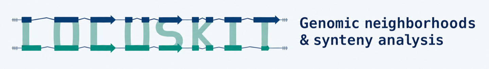

LOCUSKIT extracts genomic loci and strand-aware gene neighborhoods, converts
GeneGalleon tree-plot synteny tables, and runs FractBias analyses of gene
retention and fractionation after genome duplication.

## Install from source

On Linux or macOS, use Python 3.11 or newer.

```bash
git clone https://github.com/kfuku52/locuskit.git
cd locuskit
python3 -m venv .venv
source .venv/bin/activate
python -m pip install .
locuskit --version
```

The base installation has no third-party Python runtime dependencies. Use
`python -m pip install '.[plot]'` for FractBias plots or
`python -m pip install '.[compare]'` for JCVI comparisons. The
[FractBias guide](docs/fractbias.md#installation) lists the external aligners
required for end-to-end comparison.

## Try a gene neighborhood

From the checkout root, use the bundled synthetic GFF3 annotations, focal-gene
mapping and neighbor groups. The commands write their outputs to a temporary
directory.

```bash
work=$(mktemp -d)
locuskit loci --manifest_tsv examples/neighborhoods/genomes.tsv --out_file "$work/loci.tsv"
locuskit neighbors --loci_tsv "$work/loci.tsv" --focal_tsv examples/neighborhoods/mapping.tsv \
  --groups_tsv examples/neighborhoods/groups.tsv --window 1 --out_file "$work/family.context.tsv"
locuskit validate --in_file "$work/family.context.tsv" --focal_tsv examples/neighborhoods/mapping.tsv
```

Validation reports two focal records and four neighbor records. The context
TSV records genomic intervals, signed ranks relative to the focal strand,
and observed coverage. Optional group assignments can come from a group table,
precomputed DIAMOND hits, or a local DIAMOND run on the neighborhood proteins.

| Task | Guide |
| --- | --- |
| Define inputs, interpret missing context, or add similarity groups | [Neighborhood formats](docs/neighborhoods.md) |
| Convert to or from the GeneGalleon tree-plot TSV | [GeneGalleon interchange](docs/neighborhoods.md#use-existing-genegalleon-output) |
| Run FractBias or migrate an existing `kffractbias` workflow | [FractBias user guide](docs/fractbias.md) |
| Reproduce retention profiles from bundled BED and anchors | [Minimal FractBias example](examples/minimal/README.md) |
| Find additional examples, methods, and troubleshooting | [Documentation index](docs/README.md) |

## FractBias example

`locuskit fractbias` and the compatibility command `kffractbias` run the same
analysis. The synthetic example shows sliding-window retention on two query
chromosomes. [Reproduce the figures](examples/plots/README.md).


## Cite and contribute

Cite LOCUSKIT using [CITATION.cff](CITATION.cff). For FractBias analyses, also
cite the [original FractBias paper](https://doi.org/10.1093/bioinformatics/btw666).

LOCUSKIT uses the [MIT License](LICENSE), which retains the
original FractBias copyright. See [Contributing](CONTRIBUTING.md), the
[Changelog](CHANGELOG.md), and the [Security policy](SECURITY.md).
